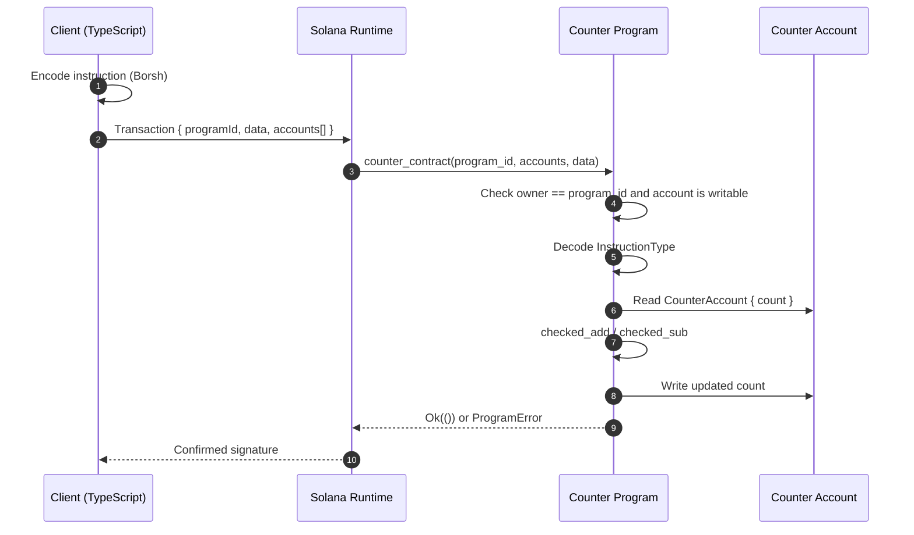
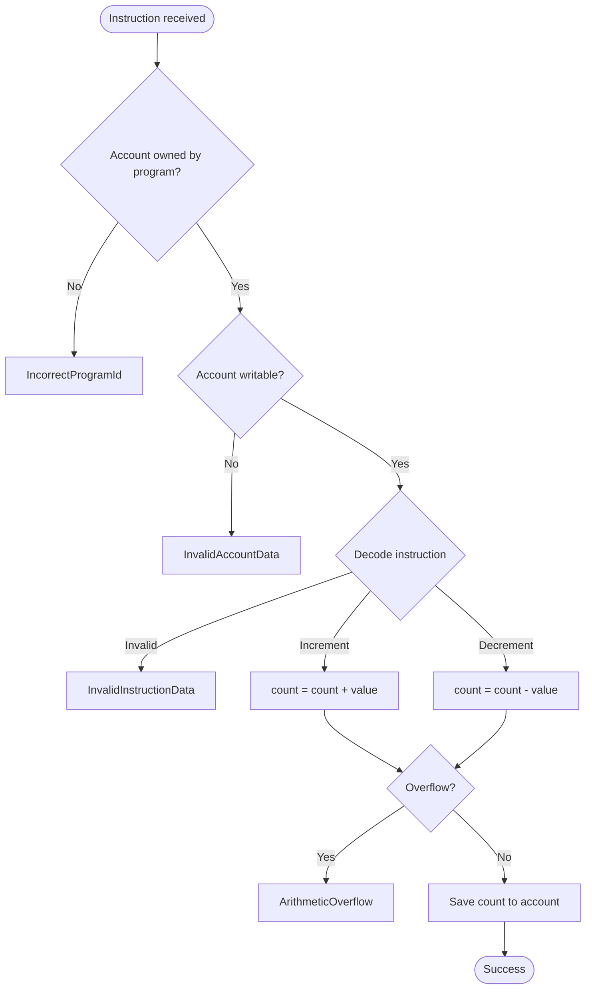

<div align="center">

# ⚡ Sol Counter Program

**A minimal on-chain counter for Solana. Increment or decrement a value stored in any program-owned account.**


[Overview](#-overview) · [Workflow](#-workflow) · [Data Layout](#-data-layout) · [Quick Start](#-quick-start) · [Project Structure](#-project-structure)

</div>

---

## ✨ Overview

This is a first Solana smart contract (a *program*, in Solana terms) built with native Rust and no framework. It shows the core Solana model in about 80 lines:

- **Programs are stateless.** All state lives in separate **accounts**.
- A client sends an **instruction** containing `programId`, `instruction_data` and `accounts[]`.
- The program reads the instruction, loads the counter account, updates it and saves it back.

| Feature | Details |
| --- | --- |
| ➕ **Increment** | Adds a `u32` value to the counter |
| ➖ **Decrement** | Subtracts a `u32` value from the counter |
| 🎯 **Any address** | Works on whichever counter account you pass in |
| 🛡️ **Safe math** | Overflow and underflow return an error instead of wrapping |
| 🔒 **Ownership check** | Only accounts owned by this program can be modified |
| 🧪 **Tested** | Rust tests (`solana-program-test`) and TypeScript client tests |

---

## 🔄 Workflow



### Program logic



---

## 🧬 Data Layout

All data is serialized with [Borsh](https://borsh.io).

### Instruction data (5 bytes)

| Byte | 0 | 1 – 4 |
| --- | --- | --- |
| **Field** | Variant tag | `u32` value (little-endian) |
| **Increment(n)** | `0` | `n` |
| **Decrement(n)** | `1` | `n` |

Example: `Increment(1)` is `[0, 1, 0, 0, 0]` and `Decrement(4)` is `[1, 4, 0, 0, 0]`.

### Counter account (4 bytes)

```rust
pub struct CounterAccount {
    pub count: u32,
}
```

### Accounts expected

| Index | Account | Writable | Signer | Notes |
| --- | --- | :---: | :---: | --- |
| 0 | Counter account | ✅ | ❌ | Must be owned by this program |

### Errors

| Error | When |
| --- | --- |
| `IncorrectProgramId` | Counter account is not owned by this program |
| `InvalidAccountData` | Account is not writable, or its data is not a valid counter |
| `InvalidInstructionData` | Instruction bytes cannot be decoded |
| `ArithmeticOverflow` | Result would go above `u32::MAX` or below `0` |
| `AccountDataTooSmall` | Account has fewer than 4 bytes of space |

---

## 🚀 Quick Start

### Prerequisites

- [Rust](https://rustup.rs)
- [Solana CLI](https://solana.com/docs/intro/installation) (includes `cargo build-sbf` and `solana-test-validator`)
- [Bun](https://bun.sh)

> 🪟 **Windows:** the Solana CLI and validator run through [WSL](https://learn.microsoft.com/windows/wsl/install) (Ubuntu).

### 1. Run the Rust tests

```bash
cargo test
```

### 2. Build and deploy locally

```bash
solana config set --url localhost
solana-keygen new                       # first time only

# terminal 1 (keep open)
solana-test-validator

# terminal 2
cargo build-sbf
solana airdrop 5
solana program deploy target/deploy/sol_counter_program.so
# note the printed Program Id
```

### 3. Run the client tests

```bash
cd client
bun install
PROGRAM_ID=<your_program_id> bun test
```

`RPC_URL` defaults to `http://127.0.0.1:8899`. Set it to target another cluster.

### Deploy to Devnet

```bash
solana config set --url devnet
solana airdrop 2
cargo build-sbf
solana program deploy target/deploy/sol_counter_program.so
```

---

## 💻 Client Usage

```ts
import { Connection, Keypair, PublicKey } from "@solana/web3.js";
import { createCounterAccount, updateCounter, readCounter } from "./counter";

const connection = new Connection("http://127.0.0.1:8899", "confirmed");
const programId = new PublicKey("<PROGRAM_ID>");
const payer = Keypair.generate();    // fund it first
const counter = Keypair.generate();

await createCounterAccount(connection, payer, counter, programId);

await updateCounter(connection, payer, counter.publicKey, programId, "increment", 5);
await updateCounter(connection, payer, counter.publicKey, programId, "decrement", 2);

console.log(await readCounter(connection, counter.publicKey)); // 3
```

---

## 📁 Project Structure

```
sol-counter-program/
├── src/
│   └── lib.rs            # Program: entrypoint, instructions, account state
├── tests/
│   └── counter.rs        # Rust tests (solana-program-test)
├── client/
│   ├── counter.ts        # Client helpers: create, update, read
│   ├── counter.test.ts   # Client tests (bun test)
│   ├── package.json
│   └── tsconfig.json
├── Cargo.toml
└── README.md
```

---

## ⚠️ Security Notes

This is a learning project. The program does **not** require a signer or an authority, so **anyone** can change any counter account owned by it. For a real application, store an authority pubkey in the account and check that it signed the transaction.

---

## 📄 License

Released under the [MIT License](LICENSE).

<div align="center">

Built with 🦀 Rust on ⚡ Solana

</div>
